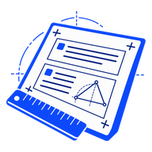
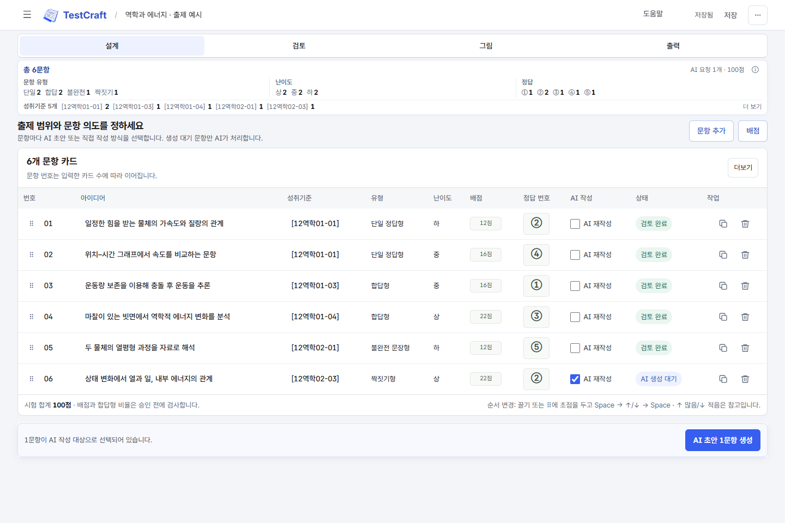
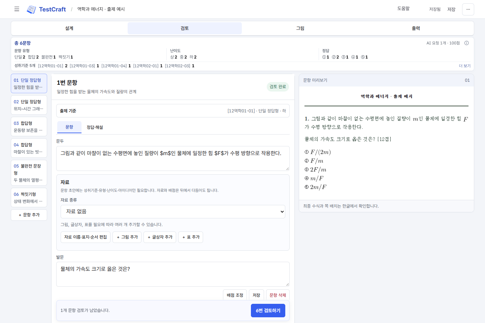
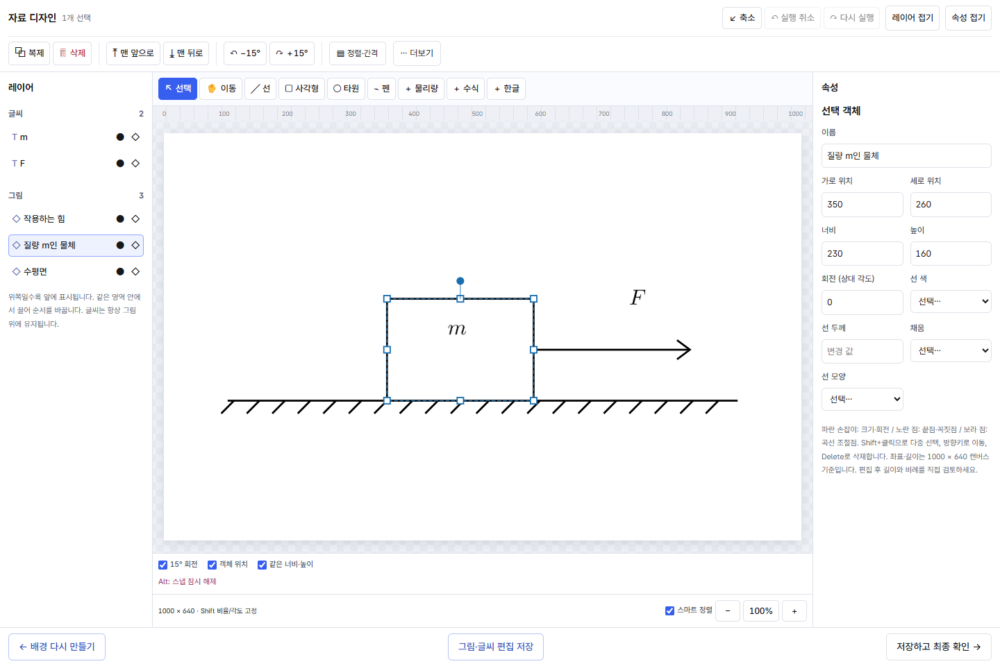

<div align="center">



# TestCraft

### 평가의 의도를 담아, 시험을 빚다.

성취기준에서 출발해 문항을 설계하고, AI 초안을 검토하고,<br>
자료 그림과 시험지·답지까지 완성하는 **교사를 위한 시험공방**입니다.

[](https://shy.ai.kr/testcraft/#download)
[](https://github.com/sehunYang/testcraft/releases/latest)
[](https://shy.ai.kr/testcraft/#faq)
[](LICENSE)

**[🌐 TestCraft 안내 페이지](https://shy.ai.kr/testcraft/)** · **[⬇️ Windows 다운로드](https://github.com/sehunYang/testcraft/releases/latest)**

[왜 TestCraft?](#why-testcraft) · [작업실 둘러보기](#the-workshop) · [설치](#installation) · [자주 묻는 질문](#faq) · [개발](#development)

</div>

<br>

<a id="why-testcraft"></a>
## 🧭 출제의 중심은, 선생님의 의도입니다

> **“무엇을 묻고 싶은가?”에서 시작해, 실제 시험지까지.**

문항카드에 설계한 의도를 AI에 옮기고, 그림을 따로 만들고, 다시 시험지 양식에 넣는 일은 서로 떨어져 있기 쉽습니다. TestCraft는 이 과정을 **설계 → 검토 → 그림 → 출력**이라는 하나의 작업 흐름으로 묶었습니다.

AI가 초안을 쓰더라도 문항·정답·해설과 배점은 교사가 검토합니다. **전체 문항카드를 승인한 뒤 실제 그림 제작과 시험지 출력으로 진행**합니다.

<br>

<a id="the-workshop"></a>
## 🖥️ 작업실을 둘러보세요

아래는 실제 앱에 **공개용 예시 문항**을 넣은 화면입니다. 학교의 실제 시험이나 학생 자료를 사용하지 않았습니다. 버전에 따라 일부 배치는 달라질 수 있습니다.

### 01. 설계 — 네 가지 기준으로 문항의 방향을

**성취기준 · 문항 유형 · 난이도 · 문항 핵심 아이디어**를 입력합니다. AI 초안을 요청하거나 문두와 보기를 직접 작성할 수 있습니다. 배점은 초안 입력 시 필수가 아니며, 검토 단계에서 다듬습니다.



| 시험 전체를 보며 | 문항 하나를 다듬으며 |
|---|---|
| 유형·난이도·정답의 비중을 색으로 확인 | AI 요청 문항만 골라 일괄 생성 |
| 사용한 성취기준만 간결하게 표시 | 복제·삭제·드래그로 순서 변경 |
| 실제 입력한 문항 수에 맞춰 구성 | 과목 안의 성취기준에서 선택 |

### 02. 검토 — 초안은 AI가, 마지막 판단은 선생님이

문두·발문·보기·정답과 해설을 미리보며 직접 수정하거나 AI 수정 요청을 보냅니다. 문항 유형은 **단일 정답형·합답형·불완전 문장형·짝짓기형**을 지원합니다.



그림·글상자·표를 함께 구성할 수 있고, (가)·(나)처럼 여러 그림을 넣을 수 있습니다. 난이도에 따른 **100점 합계 배점**을 검토하고 전체 문항카드를 승인합니다.

### 03. 자료 디자인 — 그림은 정교하게, 글씨는 자유롭게

그림은 제작 범위에 따라 `strict` · `mixed` · `flexible`로 나눕니다. 글씨는 그림에 섞어 생성하지 않고 **물리량·수식·한글을 독립 객체**로 배치합니다.



- **SVG 객체 편집**: 이동, 크기 조절, 회전, 15도 단위 회전 스냅, 객체 간 정렬·크기 스냅
- **레이어 편집**: 복제·삭제·앞뒤 순서·잠금·숨김, 글씨 추가와 후편집
- **배경과 글씨 분리**: 배경을 다시 만들어도 기존 글씨 레이어 유지
- **집중 편집**: 넓게 편집하고, 최종 합성 미리보기에서 확정

<details>
<summary>그림 유형과 글꼴 자세히 보기</summary>

| 유형 | SVG 고정 영역 | 창작 허용 영역 |
|---|---|---|
| `strict` | 정확한 값·비례·도형을 규칙으로 지정 | 비워 둠 |
| `mixed` | 정확히 고정할 요소 지정 | 고정 영역과 **다른 요소**만 지정 |
| `flexible` | 비워 둠 | 모든 그림 요소 지정 |

물리량과 수식은 **Latin Modern Math**, 한글은 **신명 중명조**를 사용합니다. Latin Modern Math는 포함하며, 신명 중명조는 사용자의 한글 설치 환경에서 불러옵니다.

</details>

### 04. 출력 — 시험지와 답지까지 같은 흐름에서

| 산출물 | 형식 |
|---|---|
| 학교 양식 학생용·교사용 시험지 | **HWPX** · 한글 수식 포함 |
| 정답과 해설 | **HWPX** · 정답 요약표와 문항별 풀이 |
| 문항카드 | XLSX |
| 한 번에 받기 | ZIP |

한글이 설치된 환경에서 앱이 내부 HML을 별도의 숨김 한글 프로세스로 열어 **학생용·교사용 시험지와 정답·해설 HWPX로 변환하고 검증**합니다. 출력 ZIP에는 최종 HWPX를 담으며, 내부 HML은 작업용으로 보존합니다.

<br>

<a id="installation"></a>
## 📦 설치하고 첫 시험 만들기

### 먼저 확인하세요

| 필요한 것 | 설명 |
|---|---|
| **Windows 10/11 · x64** | 설치 파일과 무설치 ZIP 제공 |
| **Codex 사용이 가능한 유료 ChatGPT 계정** | 첫 실행에서 공식 로그인 화면으로 연결 |
| **한컴오피스 한글** | HWPX 변환·수식 크기 계산 및 신명 중명조 글씨에 필요 |
| **인터넷 연결** | 로그인과 AI 생성 시 필요 |

> [!IMPORTANT]
> **앱 설치 파일에는 Python·Node.js·Codex CLI가 포함**되어 있습니다. 별도 API 키를 입력하지 않습니다. AI 서비스 구독과 한글 프로그램은 별도로 준비해야 합니다.

### 세 단계면 작업실이 열립니다

1. **[최신 릴리스](https://github.com/sehunYang/testcraft/releases/latest)**에서 `TestCraft-<버전>-windows-x64-setup.exe`를 받아 설치합니다.
2. 시작 메뉴의 **TestCraft**를 실행하고, 내장 CLI 확인 후 **Codex 계정으로 로그인**을 눌러 인증합니다.
3. **새 시험 만들기**에서 과목을 고르고, 첫 문항의 출제 기준을 입력합니다.

설치 없이 쓰려면 같은 릴리스의 `portable.zip`을 풀고 `TestCraft.exe`를 실행합니다. 파일 검증용 `SHA256SUMS`도 함께 제공합니다.

<br>

<a id="faq"></a>
## 💬 자주 묻는 질문

<details>
<summary><b>웹사이트에서 바로 문항을 만드나요?</b></summary>

Windows에 설치하는 **로컬 앱**입니다. 앱을 실행하면 내 컴퓨터의 브라우저 화면에서 작업합니다. [안내 사이트](https://shy.ai.kr/testcraft/)는 기능 소개와 다운로드 페이지입니다.

</details>

<details>
<summary><b>작업물과 로그인 정보는 어디에 저장되나요?</b></summary>

새 설치의 시험과 그림은 `%LOCALAPPDATA%\TestCraft`에 저장됩니다. 이전 Question Studio 설치의 `%LOCALAPPDATA%\QuestionStudio` 폴더가 있으면 그 위치를 계속 사용해 기존 작업물과 로그인 정보를 보존합니다. 앱 제거 시 작업물 폴더를 삭제하지 않습니다.

AI 기능을 실행하면 선택한 문항 내용이 로그인한 Codex 서비스로 전달됩니다. 공개 저장소와 설치 파일에는 실제 시험·학생 성적·학급 통계·사용자 인증 정보를 포함하지 않습니다.

</details>

<details>
<summary><b>한글이 없어도 사용할 수 있나요?</b></summary>

문항 설계와 검토는 가능합니다. **최종 HWPX 변환에는 설치된 한컴오피스 한글이 필요**합니다. 한글 프로그램과 신명 중명조 글꼴은 재배포하지 않습니다. 출력한 시험지는 인쇄 전 배치와 수식을 확인하세요.

</details>

<details>
<summary><b>문제가 생기거나 기능을 제안하고 싶어요.</b></summary>

[Issues](https://github.com/sehunYang/testcraft/issues)에 사용 버전과 재현 방법을 알려 주세요. 실제 시험 내용이나 계정 정보는 올리지 않도록 주의해 주세요.

</details>

<br>

<a id="development"></a>
## 🛠️ 개발과 기여

<details>
<summary>소스 실행 · 테스트 · 설치 파일 빌드</summary>

```powershell
python -m pip install -r requirements.txt
npm ci
python run_studio.py
```

개발 모드는 기존 Codex/Claude 연결도 지원합니다. 설치 배포본은 내장 Codex와 유료 계정 로그인 흐름을 사용합니다. 설치 모드를 소스에서 점검하려면 `QUESTION_STUDIO_INSTALLED=1`을 설정합니다.

```powershell
New-Item -ItemType Directory -Force .runtime
python -m unittest discover -s tests -p "test_*.py"
```

재현 가능한 설치 파일 빌드는 [packaging/README.md](packaging/README.md), 출제 절차는 [통합 앱 사용법](instructions/통합-앱-사용법.md)을 참고하세요.

</details>

<details>
<summary>GitHub Pages 안내 사이트</summary>

`docs/`의 HTML·CSS·JavaScript로 구성합니다. 별도 프레임워크나 브라우저용 API 키가 필요하지 않습니다.

```powershell
python tools/build_site.py --output .runtime/pages
python -m http.server 8080 --directory .runtime/pages
```

`docs/` 변경 또는 새 릴리스 공개 시 GitHub Actions가 Pages를 배포합니다. 배포 중 최신 공개 릴리스의 실제 파일명·다운로드 주소·크기·체크섬을 검증해 `release.json`을 갱신합니다. 앱 파일은 **GitHub Releases**에서 내려받으며 Pages에는 안내 페이지와 공개 예시 이미지만 배포합니다.

</details>

<br>

## 📄 라이선스

**[GNU AGPL-3.0](LICENSE)** © sehunYang

외부 구성 요소는 각자의 라이선스를 유지합니다. [THIRD_PARTY_NOTICES.md](THIRD_PARTY_NOTICES.md)와 설치 폴더의 `notices`를 참고하세요. TestCraft는 OpenAI 또는 한컴의 공식 제품이 아닙니다.

## 영상으로 시작하기

[7편의 한국어 사용 튜토리얼과 30초 소개 영상](https://shy.ai.kr/testcraft/#tutorials)을 제공합니다. 앱 상단의 **도움말**은 현재 화면에 맞는 영상과 실제 버튼을 강조하는 따라 하기 안내를 엽니다.

공통 오리지널 음악 *Quiet Precision*은 튜토리얼 108 BPM과 홍보 리프라이즈 128 BPM으로 편곡했습니다. 실제 앱 조작을 녹화했으며 AI 생성 대기는 단축 표시합니다. [영상·음악 제작 소스](instructions/영상-제작-운영.md)도 공개합니다.
